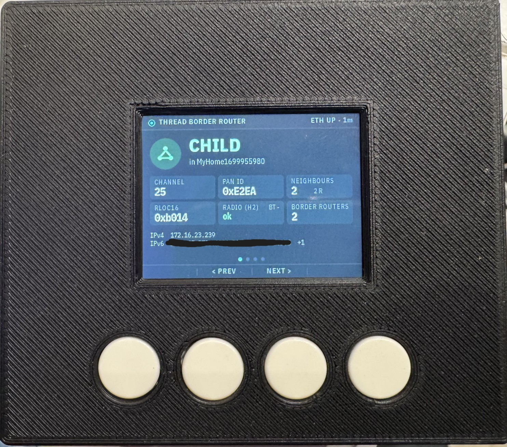
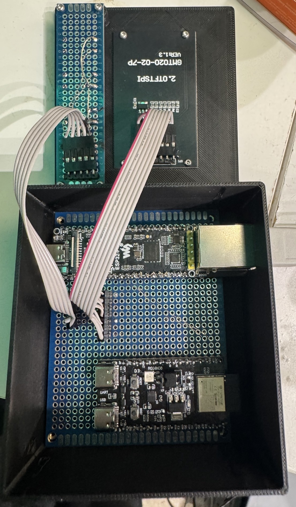
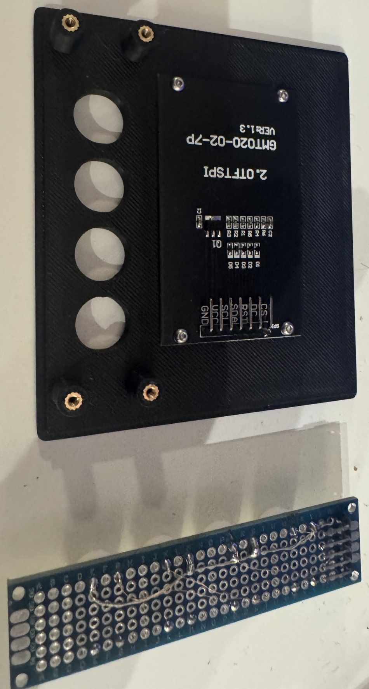

# ebr — esp border router

A Thread border router built from inexpensive ESP32 boards, with a small status display and four buttons, that
**joins an existing Apple Home Thread network** — added in the Home app like any Matter accessory.



## Why

My Thread network is formed by an Apple TV, the only border router in the house, and Thread devices further away
in the house could not reach it. I wanted a cheap Thread border router that **extends that network** rather than
starting a second one next to it — something I can put wherever coverage is missing, and that shows what it is
doing on a display.

## What is unusual about it

To join an existing Thread network, a border router needs that network's credentials (the active dataset, which
contains the network key). DIY border routers usually either form a network of their own or need the dataset
copied over by hand — and Apple does not hand it out.

ebr gets it the way every Thread accessory does: **it is a Matter device.** The display shows a pairing QR code;
the Home app pairs it over Bluetooth and, as part of commissioning, gives it the Thread dataset. ebr then starts
Thread with that dataset and works as a border router in Apple's network: routing between Thread and the Ethernet
LAN, SRP server, advertising proxy. It stays a Matter device (shown in Home as "Matter Accessory"); **removing it in
the Home app factory-resets it** and the pairing QR comes back.

## Features

- Thread border router (OpenThread) on Ethernet; joins the Apple TV's network, never forms its own.
- Matter device (esp-matter): pairing from the QR or the setup code on the display, Thread dataset from
  commissioning, factory reset when removed in Home.
- 2.0" display (LVGL) with pages for status (role, network, channel, PAN ID, neighbours, border routers,
  addresses), neighbours, network addresses and the device; dark by default, on at boot and on any button press
  for 5 minutes.
- Four buttons with a soft-key bar: BACK, PREV, NEXT, SELECT. Factory reset on the device by holding SELECT until a
  progress bar is full.
- No web server: esp-thread-br's REST API has no authentication and would hand the network key to anyone on the
  LAN ([notes/rest-api.md](notes/rest-api.md)).

## Hardware

| Part | Role |
| --- | --- |
| [Waveshare ESP32-P4-ETH](https://www.waveshare.com/wiki/ESP32-P4-ETH) | main board: Matter, OpenThread border router, display; 100 Mbit Ethernet |
| ESP32-H2 devkit (ESP32-H2-MINI-1) | the radio for Thread **and** Bluetooth LE (OpenThread RCP + BLE controller); flashed by the P4 itself |
| 2.0" ST7789 TFT, 240×320 (GMT020-02-7P) | status display |
| 4 push buttons | under the display |
| PNP transistor or P-MOSFET + 2 resistors | switches the display's power (the module has no backlight pin) |

Wiring, the header pinout and the display power switch: [notes/hardware-setup.md](notes/hardware-setup.md).



## Case

3D-printed, two parts — a box for the boards and a lid that carries the display and the buttons. Fusion 360
sources and STL files in [case/](case/).



## Firmware

[firmware/](firmware/) — ESP-IDF v5.5 + esp-matter; build, flash and how the P4 and the H2 talk to each other in
[firmware/README.md](firmware/README.md). In short:

```sh
. ~/esp/esp-idf/export.sh && . ~/esp/esp-matter/export.sh
(cd firmware/rcp_h2 && idf.py set-target esp32h2 build)   # the H2 image, packed into the P4 firmware
cd firmware/ebr && idf.py set-target esp32p4 build flash
```

The pairing uses Matter **test** credentials (test vendor ID, Espressif's test certificates, a fixed setup code);
Apple Home warns about an uncertified accessory and lets you add it anyway. Everyone who builds ebr gets the same
setup code.

## Status

Working: paired in Apple Home and a router in the Apple TV's Thread network. Known issues are listed in
[firmware/README.md](firmware/README.md#known-issues). Ideas for later — Thread 1.4 credential sharing, a remote
for other Matter devices on the display, standalone use without an Apple hub — are in [notes/](notes/).

## Trademark and Certification Notices

> [!IMPORTANT]
> This project implements the Matter protocol and the Thread networking protocol. Matter™ is a trademark of the
> Connectivity Standards Alliance; Thread® is a trademark of the Thread Group, Inc. Apple, Apple TV and Apple Home
> are trademarks of Apple Inc.
>
> This project is **not** certified by, endorsed by, supported by, or affiliated with the Connectivity Standards
> Alliance, the Thread Group, Apple, Espressif or Waveshare. ebr uses Matter **test** credentials and is not a
> certified Matter or Thread product.

## License

[MIT](LICENSE) © Sebastian Raff (hobbyquaker) — the source code, the case files and the images.

Not covered by it: the bitmap fonts in `firmware/components/br_display/fonts/` are converted from IBM Plex and stay
under the [SIL Open Font License 1.1](firmware/components/br_display/fonts/OFL.txt). The two files in
`firmware/rcp_h2/main/` that come from ESP-IDF's `ot_rcp` example keep their CC0 header. The frameworks fetched at
build time keep their own licences (ESP-IDF, esp-matter, the Matter SDK, NimBLE: Apache-2.0; OpenThread:
BSD-3-Clause; LVGL: MIT) — a published firmware binary has to carry their licence texts.

## Disclaimer

ebr is provided **"AS IS", WITHOUT WARRANTY OF ANY KIND**, express or implied, including but not limited to the
warranties of merchantability, fitness for a particular purpose and non-infringement. **IN NO EVENT** shall the
authors or copyright holders be liable for any claim, damages or other liability, whether in an action of contract,
tort or otherwise, arising from, out of or in connection with the software, the hardware built after this project,
or the use of either.

Building and running ebr is at your own risk — the wiring, the power supply, and what it does to your network: it
joins your Thread network, holds that network's key and routes between Thread and your LAN. Use it only on networks
that are yours.
