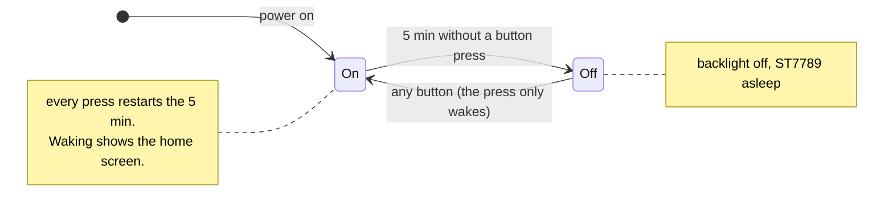

# Display and buttons: what the screens do

*Started 2026-10-18 with these wishes: display dark by default, four buttons under it, evenly spaced
("select, back, prev, next"). This note is the plan; what is built is marked. Code:
`firmware/components/br_display`; looks: design direction A on the
[design canvas](https://claude.ai/artifact/JS4Bp3QNGs2wz1DgyUVH4Y).*

## Front panel

```
┌────────────────────────────────────────┐
│                                        │
│          ST7789, 320 × 240             │
│                                        │
│                 ● ○                    │  ← page dots
├─────────┬─────────┬─────────┬──────────┤
│  HOME   │ < PREV  │ NEXT >  │  SHOW    │  ← soft-key bar: each label names what its button does now
└─────────┴─────────┴─────────┴──────────┘
   [BACK]    [PREV]    [NEXT]   [SELECT]     ← the four buttons, one under each cell (80 px apart)
```

- **Order, left to right: BACK, PREV, NEXT, SELECT** — back on the left, the action on the right, the two
  arrows together in the middle (agent proposal; change `KEY_ORDER` in `br_ui.c` and this table for
  another order).
- The bottom bar has one cell per button; a cell's label says what that button does **on this screen**, an empty
  cell means the button does nothing there. So a button can mean more than its name (SELECT says SHOW, START,
  OPEN …) without the user learning a manual.
- The waking press (display dark) only wakes; it does not act.

## Power: dark by default *(built)*



`BR_DISPLAY_ON_SECONDS` = 300 (0 = always on). Screens that show a secret close themselves earlier (below), so
the display never goes dark with a secret on it and never wakes up showing one.

## Screens and buttons

Dashed boxes are planned, solid ones built (state of 2026-10-20: ebr is a Matter device — while unpaired the home
screen is "Add to Apple Home" with the pairing QR; the old "No dataset" screen only appears without pairing codes).
Marked "v2": ideas beyond v1.

```mermaid
stateDiagram-v2
    [*] --> Starting : boot

    Starting --> AddToHome : Ethernet and radio up, not paired
    Starting --> Status : Ethernet and radio up, paired (dataset stored)
    AddToHome --> Status : paired in the Home app (dataset from the pairing)
    Status --> AddToHome : removed in the Home app (factory reset)

    state "Status (home)" as Status
    state "Add to Apple Home: QR + setup code (home while unpaired)" as AddToHome
    state "Neighbours" as Neighbours
    state "Share network" as ShareNetwork
    state "Dataset" as DatasetPage
    state "Share with another controller" as Pairing
    state "Remote (v2)" as Remote
    state "Network: IPv4, every IPv6 address" as Network
    state "Device: firmware, pairing, radio, uptime; factory reset" as Device
    state "Hold bar fills (release = cancel)" as Holding

    Status --> Remote : NEXT
    Remote --> Neighbours : NEXT
    Neighbours --> Network : NEXT
    Network --> Device : NEXT
    Device --> ShareNetwork : NEXT
    Device --> Holding : SELECT held
    Holding --> Device : released before full
    Holding --> AddToHome : bar full (5 s) = factory reset, restart
    ShareNetwork --> DatasetPage : NEXT
    DatasetPage --> Pairing : NEXT
    Pairing --> Status : NEXT

    state "Passcode + QR (ePSKc)" as Passcode
    ShareNetwork --> Passcode : SELECT = START
    Passcode --> ShareNetwork : BACK = STOP, used, or 2 min

    state "Confirm: shows the network key" as DatasetConfirm
    state "Dataset QR, secret" as DatasetQR
    DatasetPage --> DatasetConfirm : SELECT = SHOW
    DatasetConfirm --> DatasetQR : SELECT = YES
    DatasetConfirm --> DatasetPage : BACK = NO, or 10 s
    DatasetQR --> DatasetPage : BACK = HIDE, or 60 s

    state "Pairing window: QR + code" as PairingWindow
    Pairing --> PairingWindow : SELECT = OPEN
    PairingWindow --> Pairing : BACK = CLOSE, paired, or 15 min

    state "Remote list, cursor" as RemoteList
    Remote --> RemoteList : SELECT = OPEN
    RemoteList --> RemoteList : PREV/NEXT = cursor, SELECT = switch
    RemoteList --> Remote : BACK

    classDef planned stroke-dasharray: 5 5
    class ShareNetwork,Passcode,DatasetPage,DatasetConfirm,DatasetQR,Pairing,PairingWindow,Remote,RemoteList planned
```



Not drawn, to keep the diagram readable:

- **PREV** walks the same ring backwards. Built today: Status → Neighbours → Network → Device → Status.
- **BACK on any page goes home** (Status, or No dataset).
- Inside the Remote list the PREV/NEXT buttons move the cursor instead of paging (the soft-key bar shows UP, DOWN).
- While there is **no dataset** there are no pages: No dataset is the only screen, the bar is empty.

### The screens

| Screen | Shows | BACK | PREV | NEXT | SELECT | State |
| --- | --- | --- | --- | --- | --- | --- |
| Starting | role word STARTING, empty tiles | – | – | – | – | built |
| Add to Apple Home | Matter QR (BLE), setup code 4-3-4, LAN address, radio state; BT state in the header | – | – | – | – | built (2026-10-20) |
| No dataset | why Thread is off, the console commands — only without pairing codes (a firmware without Matter) | – | – | – | – | built |
| Status (home) | role, network name, channel, PAN ID, neighbours, RLOC16, RCP, border routers, IPv4 and one IPv6 address (global before ULA before link-local, "+N" for the others) | – | PREV | NEXT | – | built |
| Neighbours | role, RLOC16, link bars, RSSI, "border router" mark; up to 5 rows | HOME | PREV | NEXT | – | built |
| Network | IPv4 and every IPv6 address of the Ethernet interface (up to 8), labelled LINK / ULA / GLOBAL | HOME | PREV | NEXT | – | built (2026-10-24) |
| Device | firmware version, paired (fabric), radio + BT state, uptime; **factory reset**: hold SELECT until the amber bar is full (5 s, `BR_DISPLAY_RESET_HOLD_MS`), release cancels — then ebr forgets its pairing and the dataset and restarts unpaired (remove it in the Home app too). Only while paired | HOME | PREV | NEXT | HOLD | built (2026-10-20) |
| Share network | Thread 1.4 credential sharing: what it does, whether a commissioner is connected | HOME | PREV | NEXT | START | planned ([credential-sharing.md](credential-sharing.md)) |
| ↳ Passcode | the one-time ePSKc passcode, big, and its QR; countdown | STOP | – | – | – | planned |
| Dataset | network name, channel, PAN ID, a warning that the QR holds the network key | HOME | PREV | NEXT | SHOW | planned |
| ↳ Confirm | "This shows the network key. Show it?" | NO | – | – | YES | planned |
| ↳ Dataset QR | the active dataset as QR (design A3, amber "secret" header, countdown bar) | HIDE | – | – | – | planned |
| Remote | the remote's entries at a glance | HOME | PREV | NEXT | OPEN | v2 idea ([virtual-remote.md](virtual-remote.md)) |
| ↳ Remote list | entries with a cursor; state next to each (option B/C) or "sent" (option A) | BACK | UP | DOWN | SWITCH | v2 idea |
| Share with another controller | the fabrics the router is in (Apple Home, …) | HOME | PREV | NEXT | OPEN | planned (multi-admin, e.g. she) |
| ↳ Pairing window | opens a commissioning window; Matter QR + manual code; countdown | CLOSE | – | – | – | planned |

### Rules for the secret screens

- The dataset QR holds the **network key** of the production network: two presses to get there (SHOW, YES),
  **60 s** at most, BACK hides it at once, it never survives the display going dark, and nothing logs it.
- The ePSKc passcode is short-lived by design (OpenThread's ephemeral key: 2 min by default, single use); the
  screen closes when the key expires or a commissioner has used it.
- The Matter pairing window follows the Matter default of 15 min; CLOSE revokes it.
- Status, Neighbours and the page screens hold nothing secret: network name, channel and PAN ID are in every
  Thread beacon.

## Open

- Whether the header has 4 free GPIOs for the buttons; fallbacks (resistor ladder on one ADC pin, I2C expander)
  in [hardware-setup.md](hardware-setup.md), "Buttons".
- The design canvas still shows the earlier two-button footer (A · PAIR / B · DATASET); it would get the
  four-cell soft-key bar and the planned screens (Share network and Dataset pages, confirm, passcode).
- Long presses (e.g. BACK held = display off at once) — not planned unless wanted.
